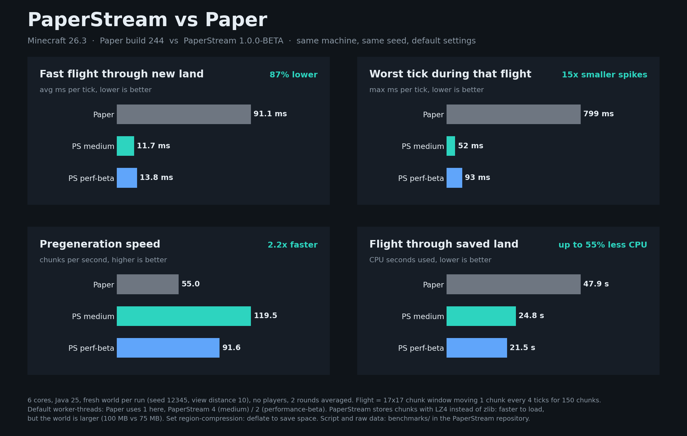

# Paper vs PaperStream, 2026-11-07

## Setup

- One Pterodactyl server with 6 cores, Java 25, the same machine for every run
- Paper 26.3 build 244 against PaperStream 26.3 1.0.0-BETA, once with the default profile `medium` and once with `performance-beta`
- Every run starts with a fresh world: seed 12345, view distance 10, simulation distance 8, no players, no plugins except the measuring plugin in `chunkbench-plugin/`
- All settings are the defaults, `worker-threads: -1` (auto)
- 2 rounds, variants alternating, the table shows the average of both rounds

Tests:

1. **Pregeneration**: generate 961 chunks (radius 15) with 64 requests at the same time
2. **Flight through new land**: a 17x17 chunk window moves 150 chunks, one chunk every 4 ticks, like a player flying fast. The chunks have to be generated.
3. **Flight through saved land**: the same flight after a restart, the chunks come from disk

## Results

| | Paper | PaperStream medium | PaperStream performance-beta |
|---|---|---|---|
| Worker threads (auto) | 1 | 4 | 2 |
| Pregeneration, chunks per second | 55.0 | **119.5** | 91.6 |
| Pregeneration, CPU per chunk | 36.5 ms | 41.8 ms | 37.3 ms |
| Pregeneration, avg MSPT | **2.37** | 5.45 | 3.97 |
| Flight through new land, avg MSPT | 91.1 | **11.7** | 13.8 |
| Flight through new land, max MSPT | 799 | **52** | 93 |
| Flight through new land, CPU | 72.4 s | 79.7 s | **67.2 s** |
| Flight through saved land, avg MSPT | 6.77 | 6.43 | **5.67** |
| Flight through saved land, CPU | 47.9 s | 24.8 s | **21.5 s** |
| Startup, fresh world | 8.5 s | 7.7 s | 7.7 s |
| Startup, existing world | 5.6 s | 6.1 s | 5.5 s |
| RAM after the flight | 1.93 GB | 2.03 GB | 2.01 GB |
| World on disk | **75 MB** | 100 MB | 100 MB |

Raw numbers per run are in `results.jsonl`.

RAM is covered separately in [RAM.md](RAM.md): no leak, the same memory as Paper once chunks are unloaded.

## What this means

Where PaperStream is better:

- Flying fast through new land keeps the server playable: 12 to 14 ms per tick on average instead of 91 ms, spikes below 100 ms instead of 800 ms. Paper drops to about 11 TPS there.
- Pregeneration is more than twice as fast with `medium`.
- Flying through saved land needs half the CPU.
- `performance-beta` uses the least CPU in every test.

Where it is not, or where it needs context:

- A large part of the lead while generating comes from more worker threads. Paper uses only a part of the cores by default. A Paper admin can raise `worker-threads` and gets some of the difference back. This benchmark shows the defaults.
- During pregeneration the MSPT is higher with `medium` (5.5 instead of 2.4 ms), because more chunks are generated at once. At 20 TPS this is not noticeable, but it is measurable.
- With `medium` a generated chunk costs about 15% more CPU time in total (more threads, more coordination). `performance-beta` is on par with Paper.
- The world is 33% larger. PaperStream writes new chunks with LZ4 instead of zlib (`region-compression: lz4` in `paperstream.yml`). LZ4 compresses less but loads much faster, which is part of the lower CPU when loading saved chunks. Set it to `deflate` to save disk space.
- RAM is about 4% higher.

Limits of this test:

- No real players, few mobs, no redstone. Older measurements for those are in the main README.
- One machine with 6 cores, 2 rounds. The rounds are close to each other (mostly less than 10% apart).

## Running it yourself

1. Build the plugin in `chunkbench-plugin/` against the Paper API and put it as `jars/ChunkBench.jar` next to the script
2. Put the server jars as `jars/paper.jar` and `jars/paperstream.jar`
3. `PTERO_KEY=<client api key> PTERO_SERVER=https://<panel>/api/client/servers/<id> python3 run_benchmark.py 2`
4. `python3 chart.py` draws `benchmark.png` from `results.jsonl`

The script stops the server, disables its plugins, runs everything in separate worlds and restores the server afterwards. Do not run it on a server with players.
